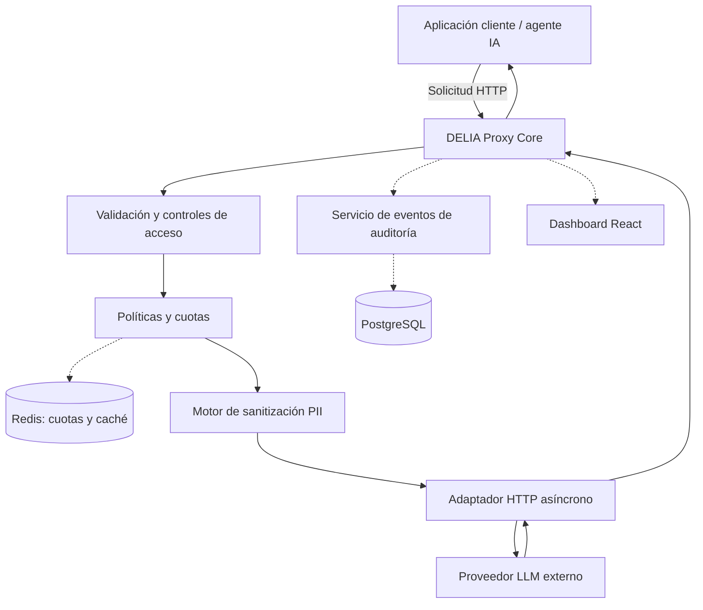

# DELIA — Data Encryption & Limiting Intelligence Agent

> **Security and governance layer for AI applications.**
>
> DELIA es un proyecto de software en desarrollo activo que busca proporcionar una capa intermediaria de seguridad entre aplicaciones corporativas y proveedores de modelos de lenguaje (LLMs). Su objetivo es reducir la exposición de datos sensibles, centralizar controles de tráfico y facilitar la trazabilidad de interacciones con sistemas de inteligencia artificial.

<p align="center">
  
  
  
  
  
  
</p>

**Estado declarado:** Sprint 2 — motor de sanitización de información personal (PII).  
**Cronograma inicial:** 12 de octubre de 2026 – 17 de enero de 2027.  
**Repositorio:** [github.com/andres-olguin/DELIA](https://github.com/andres-olguin/DELIA)

> **Aviso de estado:** DELIA está en desarrollo. Los objetivos descritos en este documento no implican que todas las funciones estén implementadas, que el sistema esté listo para producción ni que garantice cumplimiento normativo. Los estados deben actualizarse a partir del código, las pruebas y las revisiones del equipo.

---

## Tabla de contenidos

- [1. Visión y propuesta de valor](#1-visión-y-propuesta-de-valor)
- [2. Problema y alcance](#2-problema-y-alcance)
- [3. Estado de implementación](#3-estado-de-implementación)
- [4. Arquitectura objetivo](#4-arquitectura-objetivo)
- [5. Flujo de procesamiento](#5-flujo-de-procesamiento)
- [6. Sanitización y tratamiento de PII](#6-sanitización-y-tratamiento-de-pii)
- [7. Seguridad por diseño](#7-seguridad-por-diseño)
- [8. Marco regulatorio de referencia](#8-marco-regulatorio-de-referencia)
- [9. Stack tecnológico](#9-stack-tecnológico)
- [10. Inicio rápido](#10-inicio-rápido)
- [11. Ejemplo conceptual](#11-ejemplo-conceptual)
- [12. Pruebas y criterios de aceptación](#12-pruebas-y-criterios-de-aceptación)
- [13. Roadmap y Carta Gantt](#13-roadmap-y-carta-gantt)
- [14. Objetivos y métricas de éxito](#14-objetivos-y-métricas-de-éxito)
- [15. Equipo y metodología](#15-equipo-y-metodología)
- [16. Riesgos y limitaciones conocidas](#16-riesgos-y-limitaciones-conocidas)
- [17. Contribuciones](#17-contribuciones)
- [18. Licencia](#18-licencia)

## 1. Visión y propuesta de valor

Las aplicaciones basadas en LLMs pueden procesar información personal, datos comerciales confidenciales y secretos operativos. Si esos datos se envían a servicios externos sin controles apropiados, una organización puede perder visibilidad sobre qué información se comparte, cómo se aplican sus políticas y qué evidencia conserva para investigar incidentes.

DELIA busca centralizar controles técnicos en una capa intermedia entre las aplicaciones cliente y los proveedores de modelos de lenguaje. La propuesta combina detección y sanitización de datos sensibles, control de consumo, intermediación con proveedores y registro de eventos de seguridad.

### Capacidades objetivo

- **Sanitización de PII:** detectar patrones definidos y sustituir los valores antes de remitir la solicitud al proveedor.
- **DLP para flujos de IA:** reducir la exposición accidental de datos cubiertos por las reglas configuradas.
- **Rate limiting:** aplicar cuotas por cliente, identidad o política.
- **Proxy de proveedores:** normalizar el acceso a distintos proveedores de LLMs.
- **Streaming:** transmitir respuestas progresivamente cuando el adaptador y el proveedor lo permitan.
- **Fallback:** gestionar fallos del proveedor primario según políticas explícitas.
- **Auditoría:** registrar eventos operativos y de seguridad minimizando el contenido sensible almacenado.
- **Panel de control:** facilitar la supervisión de métricas y alertas en una fase posterior.

Estas capacidades son objetivos del proyecto. Su disponibilidad depende de la implementación y validación de cada módulo.

### Principio rector

**No se avanza por calendario; se avanza por evidencia.** Los sprints definen el rumbo y las fechas objetivo. La aceptación de cada entrega depende de criterios verificables, pruebas y revisión del equipo.

## 2. Problema y alcance

DELIA se orienta inicialmente a equipos que integran LLMs en aplicaciones corporativas y necesitan controles técnicos más centralizados sobre los datos enviados a proveedores externos.

Entre los datos que pueden requerir protección se encuentran:

- identificadores personales, como RUT chileno, cédulas y NIT colombianos;
- correos electrónicos y números de teléfono;
- credenciales, claves API y otros secretos;
- información comercial o contractual confidencial;
- otros datos que una organización clasifique como sensibles.

Un proxy no elimina por sí solo todos los riesgos asociados al uso de IA. La detección por patrones no cubre necesariamente información expresada en lenguaje natural, el tratamiento que realiza un proveedor externo depende de sus condiciones y configuración, y la seguridad también depende de autenticación, gestión de claves, políticas de registro, controles de salida y operación.

El alcance inicial prioriza una base técnica que pueda validarse progresivamente, sin presentar como resueltas capacidades que aún están planificadas.

## 3. Estado de implementación

La siguiente matriz combina el estado declarado y el cronograma maestro. Debe revisarse al cerrar cada tarea y no sustituye la comprobación del repositorio.

| Módulo | Estado declarado | Alcance y criterio general |
|---|---|---|
| Naming y estructura del repositorio | Completado — Sprint 1 | Repositorio organizado bajo la identidad DELIA. |
| Documentación regulatoria inicial | Completado — Sprint 1 | Documento de viabilidad para Chile y Colombia en `/docs/`, sujeto a revisión periódica. |
| Entorno base de Docker Compose | Completado — Sprint 1 | Configuración inicial, `.env.example` y conectividad base; debe validarse desde un clon limpio. |
| Regex para cédula y NIT colombianos | En desarrollo — Sprint 2 | Reglas por tipo de identificador, casos borde y validación según corresponda. |
| Validación de RUT chileno | En desarrollo — Sprint 2 | Algoritmo de dígito verificador y pruebas unitarias. |
| Script inicial de sanitización | En desarrollo — Sprint 2 | Sanitización de texto plano antes del envío al LLM. |
| Modelos de auditoría y migraciones | Planificado dentro del Sprint 2 | Modelos relacionales en PostgreSQL mediante SQLAlchemy y Alembic. La persistencia de eventos se completa en etapas posteriores. |
| Interfaz de middleware de sanitización | Planificado dentro del Sprint 2 | Integración de la lógica de sanitización en FastAPI y revisión de código. |
| Redis: rate limiting y caché | Planificado — Sprint 3 | Cuotas por usuario/cliente, caché y pruebas de carga iniciales. |
| Proxy HTTP asíncrono y SSE | Planificado — Sprint 4 | Adaptador mediante HTTPX, streaming y manejo de errores. |
| Fallback entre proveedores | Planificado — Sprint 4 | Reintentos y selección alternativa sujetos a política, timeout y compatibilidad. |
| Auditoría y endpoints de consulta | Planificado — Sprint 5 | Registro de eventos, consultas protegidas y revisión de seguridad. |
| Dashboard | Planificado — Sprint 6 | Frontend React para métricas de tráfico y alertas. |
| Pruebas de carga y release | Planificado — Sprint 6 | Pruebas con herramientas como Locust, optimización y empaquetado. |
| Piloto controlado Chile/Colombia | Planificado — Sprint 7 | Despliegue, onboarding, seguimiento de incidencias y evaluación del piloto. |

**Regla de estado:** una tarea no se considera completada solo porque exista un archivo. Debe cumplir sus criterios de aceptación y contar con evidencia de prueba o revisión adecuada.

## 4. Arquitectura objetivo

El diseño ubica a DELIA entre la aplicación cliente y el proveedor de LLM. Los componentes discontinuos representan integraciones que, según el roadmap, todavía deben implementarse.



El diagrama representa la arquitectura prevista, no una afirmación de que todas las conexiones estén operativas actualmente.

### Responsabilidades propuestas

- **Proxy Core:** coordinar el ciclo de vida de una solicitud y su respuesta.
- **Validación y acceso:** validar esquemas y, cuando esté implementado, autenticar y autorizar clientes.
- **Políticas y cuotas:** aplicar límites de consumo y decisiones de política.
- **Motor de sanitización:** detectar y sustituir patrones admitidos.
- **Adaptador HTTP:** aislar las diferencias entre APIs de proveedores, gestionar timeouts y traducir errores.
- **Auditoría:** producir eventos con minimización de datos y controles de acceso.
- **Dashboard:** exponer métricas y alertas autorizadas sin revelar contenido sensible innecesario.

### Decisiones de arquitectura pendientes

Antes de una versión de piloto se deben definir y probar: comportamiento ante fallo del sanitizador; timeouts y límites de tamaño; autenticación de clientes; gestión de claves de proveedores; destinos de salida permitidos; tratamiento de errores; retención de logs; aislamiento entre clientes; y comportamiento de seguridad cuando Redis, PostgreSQL o un proveedor no estén disponibles.

## 5. Flujo de procesamiento

El flujo funcional objetivo es:

1. **Recepción:** aceptar una solicitud HTTP en un endpoint documentado.
2. **Validación:** comprobar el esquema, tipos, campos y límites de tamaño.
3. **Autenticación y autorización:** verificar identidad y permisos según la configuración disponible.
4. **Políticas de consumo:** aplicar cuotas y restricciones, una vez implementadas.
5. **Sanitización:** detectar patrones cubiertos por las reglas y reemplazar valores según la política.
6. **Reenvío:** enviar el contenido procesado al proveedor seleccionado.
7. **Respuesta:** procesar la respuesta y aplicar controles de salida cuando estén implementados.
8. **Auditoría:** registrar eventos relevantes evitando guardar prompts, respuestas o secretos completos por defecto.
9. **Entrega:** devolver al cliente una respuesta con códigos y formato definidos.

Los pasos que dependen de módulos planificados no deben considerarse disponibles en la versión actual.

## 6. Sanitización y tratamiento de PII

El motor inicial utiliza expresiones regulares para identificar patrones estructurados. Las reglas deberán ser específicas por país y categoría, y contar con pruebas positivas y negativas.

### Ejemplo conceptual

**Entrada:**

```text
Analiza el caso del cliente con RUT 12.345.678-5 y correo contacto@empresa.cl.
```

**Salida deseada hacia el proveedor:**

```text
Analiza el caso del cliente con RUT [RUT_OCULTO] y correo [EMAIL_OCULTO].
```

Este ejemplo ilustra el resultado esperado. No demuestra que la implementación actual detecte correctamente esos valores; debe validarse con una ejecución real y pruebas automatizadas antes de presentarlo como evidencia.

### Reglas de diseño

- Separar detección sintáctica de validación semántica.
- Validar el dígito verificador del RUT chileno mediante el algoritmo correspondiente.
- Tratar cédula y NIT colombianos como categorías distintas, sin asumir que comparten un formato universal.
- Documentar formatos admitidos y casos no cubiertos.
- Medir falsos positivos y falsos negativos con datos sintéticos.
- Evitar registrar el texto original o los valores detectados innecesariamente.
- Versionar las reglas y conservar pruebas de regresión.

### Sanitización no es cifrado

- **Sanitización:** reemplaza valores por marcadores.
- **Enmascaramiento:** oculta total o parcialmente un valor.
- **Tokenización:** sustituye un valor por un token asociado mediante un mecanismo controlado.
- **Cifrado:** transforma datos mediante un algoritmo criptográfico y claves.

La sustitución por `[RUT_OCULTO]` no es cifrado. Si DELIA incorpora tokenización reversible, deberá definir dónde se guarda la correspondencia, quién puede recuperarla, cómo se protegen las claves y cómo se separan los entornos de clientes. No debe anunciarse cifrado funcional hasta que exista una implementación verificable.

Las expresiones regulares tampoco garantizan detectar nombres, datos contextuales, secretos arbitrarios ni toda forma de información personal.

## 7. Seguridad por diseño

Los siguientes puntos son requisitos que deben implementarse y verificarse antes de considerar DELIA adecuado para un entorno sensible.

| Área | Control requerido |
|---|---|
| Acceso | Autenticación y autorización de clientes. |
| Secretos | Claves API y contraseñas fuera del código y del control de versiones. |
| Transporte | TLS en despliegues fuera de un entorno local controlado. |
| Entrada | Validación de esquema, tamaño y contenido permitido. |
| Salida | Definición de controles para respuestas y errores. |
| Logs | Minimización, redacción de datos y política de retención. |
| Persistencia | Permisos mínimos y acceso restringido. |
| Egreso de red | Lista de destinos permitidos y mitigación de SSRF. |
| Disponibilidad | Timeouts, límites de tamaño y concurrencia. |
| Dependencias | Revisión de vulnerabilidades y actualizaciones. |
| Aislamiento | Separación lógica y de permisos entre clientes. |
| Pruebas | Casos de abuso, fallos parciales y regresiones de seguridad. |

### Modelo de amenazas inicial

El análisis debe incluir clientes no autorizados, abuso de cuotas, exposición de claves API, evasión de reglas de sanitización, prompt injection, registro accidental de datos sensibles, respuestas inesperadas de proveedores, destinos externos no autorizados, fallos de dependencias y errores de aislamiento entre clientes.

DELIA no debe presentarse como defensa completa contra prompt injection o exfiltración de datos sin controles específicos y pruebas que respalden esa afirmación.

## 8. Marco regulatorio de referencia

DELIA considera inicialmente los marcos de protección de datos de Chile y Colombia. El objetivo es desarrollar controles técnicos que puedan contribuir a las obligaciones de las organizaciones, no certificar cumplimiento por medio del software.

### Chile

- [Ley N.º 21.719 — Biblioteca del Congreso Nacional](https://www.bcn.cl/leychile/navegar?idNorma=1209272): reforma el marco de protección y tratamiento de datos personales.
- [Ley N.º 19.628 — Biblioteca del Congreso Nacional](https://www.bcn.cl/leychile/navegar?i=141599): marco legal de referencia cuya aplicación debe revisarse conforme a la legislación vigente y sus modificaciones.
- Para organizaciones financieras, deben revisarse también las reglas aplicables de la Comisión para el Mercado Financiero (CMF), incluida la normativa de externalización y servicios en la nube que corresponda.

### Colombia

- [Ley Estatutaria 1581 de 2012 — SIC](https://sedeelectronica.sic.gov.co/transparencia/normativa/ley-estatutaria-1581-de-2012): marco general de protección de datos personales.
- [Superintendencia de Industria y Comercio (SIC)](https://www.sic.gov.co/): fuente para consultar normativa, instrucciones y orientaciones vigentes.
- Para entidades financieras, deben revisarse además las instrucciones pertinentes de la Superintendencia Financiera de Colombia (SFC).

### Alcance de cumplimiento

El uso de sanitización, cifrado, auditoría o controles de acceso no garantiza por sí solo cumplimiento legal. La aplicabilidad depende del contexto, los roles de los actores, las finalidades del tratamiento, los contratos, las transferencias de datos y la configuración operacional.

Antes de un piloto con datos reales se recomienda validar con asesoría jurídica especializada: categorías de datos tratados, roles de responsable/encargado, flujos y destinos, retención, gestión de incidentes y obligaciones sectoriales.

El documento de investigación de mercado y viabilidad regulatoria debe mantenerse en `/docs/` y revisarse conforme cambie la normativa. Las conclusiones de ese documento son análisis de trabajo, no asesoría jurídica.

## 9. Stack tecnológico

El stack oficial definido para el proyecto es el siguiente. La inclusión de una tecnología en esta tabla indica que forma parte de la arquitectura seleccionada; no significa que su integración esté completa.

| Capa | Tecnología | Uso previsto |
|---|---|---|
| Backend y API | Python 3.11+, FastAPI, Pydantic | API HTTP, lógica de aplicación y validación de datos. |
| Cliente HTTP | HTTPX | Comunicación asíncrona con proveedores; SSE cuando esté implementado. |
| Caché y rate limiting | Redis | Cuotas compartidas y caché controlada. |
| Base de datos | PostgreSQL | Persistencia de eventos y datos operativos definidos. |
| ORM y migraciones | SQLAlchemy, Alembic | Modelos relacionales y evolución del esquema. |
| Contenerización | Docker, Docker Compose | Entorno de desarrollo y servicios. |
| Servidor | Linux / Ubuntu Server | Entorno de despliegue previsto. |
| Panel de control | React, Bootstrap o Tailwind CSS | Interfaz de métricas y alertas; el framework de estilos definitivo debe quedar registrado en las decisiones del proyecto. |
| Pruebas de carga | Locust u otra herramienta validada | Medición de latencia, concurrencia y estabilidad. |

## 10. Inicio rápido

> **Nota:** los comandos siguientes son una guía inicial. Antes de declarar esta sección verificada, comprueba que los archivos y servicios nombrados existen en la rama publicada y ejecuta el procedimiento desde un clon limpio.

### 10.1 Clonar el repositorio

```bash
git clone https://github.com/andres-olguin/DELIA.git
cd DELIA
```

### 10.2 Inspeccionar la configuración

```bash
git status
git branch --show-current
```

Comprueba si el repositorio utiliza `compose.yaml`, `compose.yml`, `docker-compose.yml`, `pyproject.toml` o `requirements.txt`. Sigue el gestor de dependencias y el archivo Compose presentes, sin asumir que todos existen.

### 10.3 Variables de entorno

Si existe `.env.example`, crea una copia local.

Linux/macOS:

```bash
cp .env.example .env
```

Windows PowerShell:

```powershell
Copy-Item .env.example .env
```

Configura únicamente las variables documentadas por la aplicación. No guardes claves API, contraseñas ni datos reales en el repositorio. `.env` debe estar excluido del control de versiones.

### 10.4 Entorno Python opcional

Si el proyecto permite ejecutar el backend localmente y declara dependencias en `requirements.txt`:

```bash
python -m venv .venv
```

Activación en Windows PowerShell:

```powershell
.\.venv\Scripts\Activate.ps1
```

Activación en Linux/macOS:

```bash
source .venv/bin/activate
```

Instalación de dependencias:

```bash
python -m pip install -r requirements.txt
```

Si el proyecto utiliza otro gestor, sigue la configuración que realmente exista.

### 10.5 Docker Compose

Si existe un archivo Compose válido:

```bash
docker compose up --build -d
docker compose ps
docker compose logs --tail=100
```

Para detener el entorno:

```bash
docker compose down
```

El resultado depende de los servicios, puertos y variables configurados en el repositorio.

### 10.6 Documentación de API

Si FastAPI está configurado para publicar Swagger UI, la ruta suele ser `/docs` en el host y puerto configurados, por ejemplo `http://127.0.0.1:8000/docs`. Confirma el puerto y la disponibilidad en la configuración real.

## 11. Ejemplo conceptual

El siguiente ejemplo representa el comportamiento deseado de una futura interfaz. No se afirma que exista un endpoint con este esquema en la versión actual.

**Solicitud original:**

```json
{
  "message": "Analiza el caso del cliente con RUT 12.345.678-5 y correo contacto@empresa.cl."
}
```

**Contenido esperado tras la sanitización:**

```json
{
  "message": "Analiza el caso del cliente con RUT [RUT_OCULTO] y correo [EMAIL_OCULTO]."
}
```

Para convertir este ejemplo en evidencia funcional se necesita un endpoint implementado, una ejecución reproducible, una prueba automatizada y una comprobación de que los registros no guardan el contenido sensible innecesariamente.

## 12. Pruebas y criterios de aceptación

### Pruebas unitarias

- RUT con dígito verificador válido e inválido.
- Formatos admitidos de cédula y NIT colombianos.
- Puntos, guiones, espacios y variaciones de escritura.
- Múltiples datos sensibles en un mismo texto.
- Entradas vacías, malformadas y casos límite.
- Falsos positivos y patrones no reconocidos.

### Pruebas de integración

- Validación de solicitudes HTTP.
- Coordinación entre middleware y sanitizador.
- Comunicación con proveedores simulados.
- Timeouts, respuestas inválidas y errores de proveedor.
- Persistencia de eventos cuando el módulo esté disponible.
- Comportamiento cuando una dependencia no responde.

### Pruebas de seguridad

- Acceso sin credenciales válidas.
- Abuso de cuotas y concurrencia.
- Exposición de secretos en logs y errores.
- Entradas excesivamente grandes o malformadas.
- Destinos de salida no autorizados.
- Aislamiento entre clientes.
- Fallos del sanitizador y política de fallo seguro.

### Criterio de aceptación

Una tarea puede declararse completada cuando cumple sus criterios de aceptación, tiene pruebas pertinentes, maneja errores previstos, dispone de documentación reproducible y ha pasado la revisión acordada. Las pruebas reducen riesgos conocidos, pero no demuestran ausencia total de vulnerabilidades.

## 13. Roadmap y Carta Gantt

Las fechas son objetivos de planificación. Los entregables pueden cambiar si aparecen riesgos, dependencias o resultados de validación que lo justifiquen.

| Sprint | Período | Objetivo y entregables principales | Hito |
|---|---|---|---|
| **1. Fundación, naming y viabilidad** | 12–25 oct. 2026 | Naming DELIA, estructura del repositorio, documento inicial de viabilidad regulatoria, Docker Compose base, `.env.example` y conectividad del entorno. | Completado según el roadmap; verificar los entregables en el repositorio. |
| **2. Sanitización PII y regex** | 26 oct.–8 nov. 2026 | Regex para cédula/NIT colombianos; algoritmo Módulo 11 para RUT chileno; script de sanitización de texto plano; modelos PostgreSQL con SQLAlchemy/Alembic para auditoría; interfaz de middleware FastAPI y code review. | **Hito 1 — 8 nov.:** validación ejecutiva y del alcance regulatorio inicial del motor PII. |
| **3. Tráfico, rate limiting y caché** | 9–22 nov. 2026 | Redis en Docker Compose; límites por minuto; caché para consultas repetidas con políticas de aislamiento; integración con rutas asíncronas; pruebas iniciales de estrés y latencia. | **Hito 2 — 22 nov.:** revisión de costos proyectados y umbrales de latencia. |
| **4. Proxy inverso y fallback de LLMs** | 23 nov.–6 dic. 2026 | Cliente HTTP asíncrono con HTTPX; soporte SSE; fallback ante fallos o timeouts; pruebas E2E con mocks de proveedores. | **Hito 3 — 6 dic.:** aprobación del flujo funcional para demostración interna. |
| **5. Auditoría y persistencia de logs** | 7–20 dic. 2026 | Registro transaccional de eventos críticos; endpoints seguros para consultar logs; documentación de despliegue, arquitectura e integración; revisión del almacenamiento y cifrado de registros. | **Hito 4 — 20 dic.:** revisión interna de seguridad de auditoría. |
| **6. Dashboard y pruebas de carga** | 21 dic. 2026–3 ene. 2027 | Panel React con métricas y alertas; pruebas de carga (por ejemplo, Locust); optimización de índices; release inicial y revisión de manuales/variables. | **Hito 5 — 3 ene.:** aprobación para entorno de pruebas controlado y definición de métricas del piloto. |
| **7. Piloto comercial Chile/Colombia** | 4–17 ene. 2027 | Despliegue en servidor cloud, dominio y TLS; onboarding de usuarios de prueba; monitoreo de incidencias, falsos positivos y rendimiento; evaluación de resultados. | **17 ene.:** cierre del ciclo inicial y evaluación del piloto. |

### Dependencias importantes

- El motor de sanitización del Sprint 2 debe integrarse con el pipeline de tráfico del Sprint 3.
- El proxy y el fallback del Sprint 4 dependen de contratos de interfaz estables y pruebas con proveedores simulados.
- Los modelos de datos iniciados en Sprint 2 no equivalen a auditoría funcional completa: la captura de eventos, consultas y revisión de seguridad se completan progresivamente.
- El piloto del Sprint 7 solo debe procesar datos reales si se han aprobado los controles, la configuración, el alcance contractual y el análisis de riesgos necesarios.

El desglose de tareas, responsables y fechas debe mantenerse en [`docs/roadmap.md`](docs/roadmap.md), siempre que ese archivo exista en la rama publicada. La investigación de mercado y viabilidad regulatoria debe mantenerse en un documento separado dentro de `/docs/`.

## 14. Objetivos y métricas de éxito

El roadmap propone objetivos iniciales. No son resultados alcanzados ni garantías de servicio.

| Métrica | Objetivo provisional | Cómo debe medirse |
|---|---|---|
| Sobrecarga de latencia | Promedio inferior a 45 ms por solicitud procesada | Definir punto de medición, tamaño de solicitud, proveedor simulado/real, concurrencia y percentiles. |
| Sobrecarga en streaming | No superar 50 ms según el objetivo del roadmap | Precisar si se mide el tiempo hasta el primer byte/token, la latencia por fragmento o la sobrecarga total. |
| Disponibilidad | ≥ 99,9 % | Definir período, exclusiones, endpoint de salud y método de cálculo. |
| Detección de PII | 100 % en el conjunto de documentos normados de prueba | Delimitar el corpus, categorías, formatos y criterios; medir también falsos positivos. No equivale a 100 % de detección en todos los datos del mundo real. |
| Resiliencia de proveedor | Fallback ante fallos cubiertos por la política | Pruebas reproducibles de timeout, errores HTTP y proveedor no disponible. |
| Seguridad de logs | Sin exposición de valores sensibles en casos de prueba definidos | Pruebas de redacción, revisión de logs y verificación de permisos. |

### Resolver una discrepancia de latencia

El roadmap contiene dos objetivos: menos de 45 ms de latencia promedio y un máximo de 50 ms de sobrecarga en streaming. No son necesariamente contradictorios, pero **no son comparables hasta definir exactamente qué mide cada uno**. Antes de declarar cumplimiento, el equipo debe especificar si la métrica es promedio, p95/p99, tiempo hasta el primer token o sobrecarga atribuible exclusivamente a DELIA.

### Cómo informar resultados

Cuando existan pruebas, publicar la configuración del entorno, la versión del código, la carga aplicada, el tamaño de las solicitudes, el número de ejecuciones y los resultados. No presentar objetivos como benchmarks obtenidos.

## 15. Equipo y metodología

### Roles declarados

| Integrante | Rol | Responsabilidades principales |
|---|---|---|
| Andrés | Líder técnico / arquitectura y desarrollo core | FastAPI, clientes HTTP asíncronos, arquitectura e integración; dashboard según el roadmap. |
| Iván | Scrum Master y desarrollador | Ciberseguridad, DLP, expresiones regulares, documentación y coordinación de ceremonias. |
| Nilson | Backend, base de datos e infraestructura | PostgreSQL, Redis, SQLAlchemy, Alembic, Docker y contenedorización. |
| Isaac | COO | Gestión, operaciones, validación regulatoria, definición de pilotos y estrategia comercial. |

### Flujo de trabajo

1. Definir historias de usuario y criterios de aceptación.
2. Dividirlas en tareas técnicas y registrar dependencias.
3. Asignar responsables y fechas objetivo.
4. Desarrollar en cambios pequeños y revisables.
5. Ejecutar pruebas pertinentes.
6. Revisar cambios antes de integrarlos.
7. Actualizar documentación y estado de implementación.
8. Registrar bloqueos, riesgos y decisiones técnicas.

### Convenciones sugeridas

Ejemplos de ramas:

```text
feature/pii-sanitization
feature/provider-adapter
fix/rut-validation
test/security-regression
docs/architecture
```

Ejemplos de commits:

```text
feat: add initial PII sanitization rules
fix: validate supported RUT formats
test: cover sanitization edge cases
docs: clarify proxy security boundaries
```

Son convenciones sugeridas, no ramas ni funcionalidades cuya existencia se afirme.

## 16. Riesgos y limitaciones conocidas

| Riesgo | Impacto potencial | Mitigación prevista |
|---|---|---|
| Falsos positivos de PII | Bloqueo o alteración de contenido legítimo | Casos borde, corpus sintético y sensibilidad configurable cuando corresponda. |
| Falsos negativos | Exposición de datos no detectados | Ampliar categorías, medir recall y documentar límites de cobertura. |
| Latencia de streaming | Experiencia de usuario degradada | Benchmarks reproducibles y pruebas de carga en Sprints 3 y 6. |
| Caída de proveedores | Solicitudes fallidas o demora | Timeouts, clasificación de errores y fallback controlado en Sprint 4. |
| Fuga en logs | Exposición centralizada de información sensible | Minimización, redacción, permisos y revisión de seguridad. |
| Compromiso de DELIA | Exposición de datos procesados por el proxy | Mínimo privilegio, protección de secretos, segmentación y evaluación de amenazas. |
| Dependencia de plataformas | Funciones similares incorporadas por proveedores cloud | Validar diferenciación en precisión local, integración, operación y evidencia de gobernanza. |
| Cambio normativo | Controles o documentación desactualizados | Seguimiento de fuentes oficiales y revisión jurídica especializada. |

### Limitaciones técnicas

- Las regex cubren solo los patrones definidos y no detectan toda la información personal.
- Sanitizar la entrada no garantiza que la respuesta del modelo no contenga información sensible.
- El proveedor externo sigue sujeto a sus propias condiciones de procesamiento y retención.
- La seudonimización reversible puede seguir implicando tratamiento de datos personales, según el contexto y la normativa aplicable.
- No se han establecido garantías de rendimiento hasta ejecutar pruebas reproducibles.
- No se debe considerar DELIA listo para producción solo porque finalice el Sprint 7; el piloto requiere aprobación de seguridad, operación y alcance legal.

## 17. Contribuciones

Las contribuciones deben mejorar la seguridad, mantenibilidad, documentación y reproducibilidad.

1. Revisar el roadmap y acordar el alcance antes de comenzar.
2. Crear una rama por cambio.
3. Añadir pruebas para el comportamiento nuevo o corregido.
4. Actualizar documentación afectada.
5. Abrir una solicitud de integración con una descripción y evidencia claras.
6. Resolver observaciones antes de integrar.

Reglas básicas:

- No incluir secretos ni datos personales reales en commits, pruebas o capturas.
- Utilizar datos sintéticos para los fixtures.
- No desactivar controles para hacer pasar pruebas.
- Justificar dependencias nuevas.
- Documentar cambios que afecten el tratamiento de datos.
- Reportar vulnerabilidades de forma responsable por el canal que el equipo defina.

## 18. Licencia

El proyecto declara la intención de utilizar la licencia MIT. Consulta [`LICENSE`](LICENSE) para los términos efectivos. Esta sección debe conservarse solo si el archivo existe y contiene el texto de la licencia correspondiente.

---

## Compromiso de DELIA

DELIA busca evolucionar hacia una capa de seguridad y gobernanza para aplicaciones basadas en inteligencia artificial. Su credibilidad dependerá de que cada capacidad se demuestre con código, pruebas, documentación y resultados reproducibles.

**La prioridad es reducir riesgos concretos y demostrar cada control antes de presentarlo como garantía de seguridad, rendimiento o cumplimiento normativo.**
