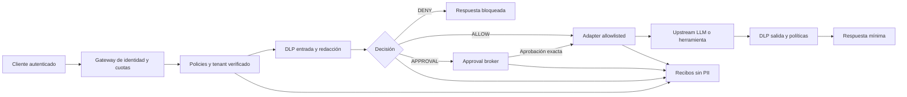

# Arquitectura objetivo — DELIA Trust Fabric

**ADR provisional 2026-11-09.** Patrón: monolito modular inicial con plano de datos y plano de control; adapters como límites explícitos. Nunca instalar como proxy de datos reales hasta cerrar P0.

## Diagrama lógico

## Trust boundaries
1. Fuera→API: identidad criptográficamente verificable, autenticación de servicio, rate limit, longitud máxima, deserialización segura.
2. Tenant→tenant: no compartir claves de cifrado, cache, filas, tickets, permisos, reportes ni métricas. Todo acceso DB con tenant filtrado a nivel servidor; pruebas de acceso cruzado.
3. Motor→herramienta: no basta que `decide()` responda DENY. El único ejecutor de herramientas debe consultar autorización atómica e impedir bypass; los adapters deben fallar cerrados.
4. Approval→ejecución: ligar digest de herramienta/argumentos/usuario/tenant/política, caducidad y consumo transaccional; reintentos idempotentes; evaluar cambios TOCTOU.
5. App→LLM: inventario de proveedores, hosts permitidos, DNS/SSRF, timeout, límites, coste, circuit breaker; rutas alternas aplican mismas políticas.
6. Auditoría: minimización estricta (hashes, evento, decisión, versión, timestamps); ningún prompt completo por defecto; firma/HMAC KMS, retención, derecho de supresión cuando proceda.
7. Multimodal: aplicar DLP a todas las superficies admitidas antes de abrir salida. Ante formato desconocido, denegar según política; nunca permitir «passthrough» accidental.

## Módulos futuros
- `auth/`: OIDC/JWT con verificación de emisor, audiencia y expiración, claves con rotación, políticas RBAC/ABAC.
- `policy/`: modelo declarativo con revisión previa a publicación, motor puro y tests de conflictos; modelo de scopes y tenant.
- `pii/`: recognizers por país, anotaciones y corpus independientes; tokens reversibles solo en Vault controlado.
- `agent/`: registro de herramientas, gateways MCP y aprobaciones; idempotency keys y adaptadores sin conexión implícita.
- `audit/`: eventos encadenados, almacén durable, redacción de datos y exportación verificable.
- `console/`: React con vistas por tenant, panel de políticas, simulación, solicitudes de aprobación e indicadores.
- `assurance/`: corpus, ataques sintéticos, coverage gates, SBOM y benchmarking comparativo reproducible.
- `market/`: catálogo firmado de plantillas de control si se valida demanda y mantenimiento.

## Contratos operativos (propuesta)
`POST /v1/decisions`: cliente autenticado, action envelope: tenant derivado del token, agente, herramienta, argumentos permitidos, correlación no sensible. Devuelve `ALLOW`, `DENY` o `PENDING_APPROVAL` más policy version, reason code, receipt ID. La autorización es una capacidad de corta vida, no un booleano que un cliente pueda ignorar.
`POST /v1/approvals/{id}`: solo aprobador con permiso verificable; objeto de aprobación exacto y TTL.
`POST /v1/execute`: el servidor integra decisión y ejecución atómicas; ningún cliente debería poder ejecutar la herramienta «por fuera» del enforcement.
`GET /v1/audit/receipts`: RBAC, filtros por tenant, acceso a metadatos y retención documentada.
`POST /v1/policies/simulate`: simulación sin ejecutar efectos; no cambia política activa.
`POST /v1/policies/publish`: dos revisores, rollback y evento firmado.

**Ninguno de estos endpoints existe aún en `trust_fabric/`.** Son contratos de la beta prevista.

## Principios arquitectónicos
- Deny by default y mínimo privilegio; la excepción necesita evidencia.
- Preferir librerías y estándares auditados a criptografía propia. HMAC del prototipo no sustituye KMS ni una bitácora durable.
- Control plane separado lógicamente de la ejecución.
- Sin datos de clientes en repositorios, issues, benchmarks públicos, demos o presentaciones.
- Métricas exportables y observabilidad definida; alertas sin PII.
- No desplegar varios microservicios por cada una de las veinte ideas; modularizar y extraer solo cuando mediciones lo exijan.

## Riesgos que permanecen abiertos en el código existente
Referir a #6, #7, #8, #9, #11 y al documento `docs/ARQUITECTURA_ESCALABILIDAD_Y_GATES_2026-11-04.md`. Este plan **no corrige** por sí mismo credenciales, persistencia, autorización ni egreso de la API actual.
